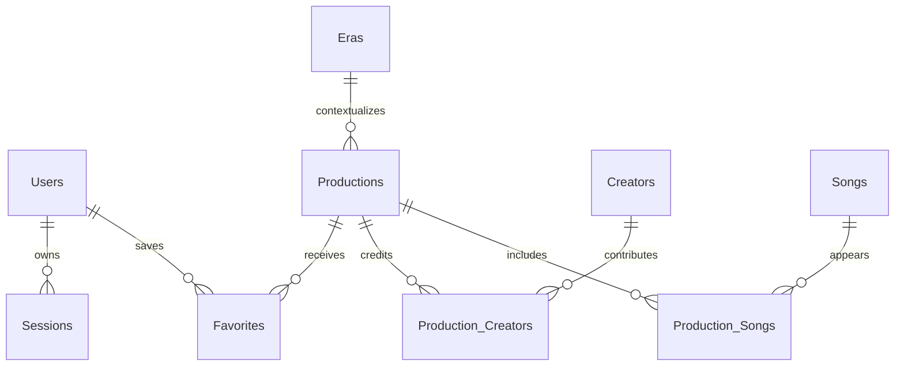

# 关系模型与验收矩阵

模型已在 PostgreSQL 落地，采用课程消息 API：POST /api/<消息名称去掉 Message 后转小写>。每张表归属其业务服务，初始化与查询分离，按已配置 Skill 落地；不重复建立另一套代码规范。

## 实体关系

| 实体 | 字段意图 | 约束 |
| --- | --- | --- |
| Users | ID、唯一邮箱、展示名、密码派生哈希/盐、角色、创建时间 | 邮箱规范化后唯一；注册不能由请求指定管理员角色 |
| Sessions | 不可逆 token 摘要、用户、过期时间 | token 不明文入库；退出撤销会话；过期不可使用 |
| Eras | ID、唯一 slug、标题、年代标签、上下文、音乐特点、排序、来源 | slug 唯一；有作品引用时删除按明确关系策略处理 |
| Productions | ID、slug、标题、开演年份及日期含义、分类、时期 FK、摘要、剧情、创作背景、音乐特点、精选、媒体/来源 | slug 唯一；年份须明确版本；未知内容不伪造 |
| Songs | ID、slug、标题、主要歌曲类型、分析、戏剧情境、来源 | 四类主分类明确；同曲可有多个分析功能标签 |
| Creators | ID、姓名、介绍、来源 | 不把同名人物简单合并；无依据简介不显示 |
| Favorites | 用户 FK、作品 FK、收藏时间 | 用户+作品复合唯一；只按可信当前身份查询/修改 |
| Production_Creators | 作品 FK、创作者 FK、职能 | 复合唯一；职能区分作曲/作词/剧本等 |
| Production_Songs | 作品 FK、歌曲 FK、显示顺序 | 复合唯一；关系写入与主体编辑事务一致 |

正式图片元数据应保留来源 URL、作者、许可、归属作品/时期、替换占位状态；是否独立媒体表依据后续实现复杂度决定。用户上传在本轮需求之外，不擅自增加。

删除作品时清理收藏与关联表，不连带删除仍被其他作品引用的歌曲或创作者。删除被引用的时期/歌曲/创作者应返回可理解的关系冲突，或由管理员在明确确认下解除关联，不静默破坏档案。

## 业务接口清单

- 档案公开读取：精选作品、时期列表与详情、作品搜索/分类/排序及详情、歌曲分类与详情、创作者资料、舞台知识和来源。
- 账户：注册、登录、退出、读取与编辑本人资料。
- 收藏：当前用户列表、添加、取消。
- 管理：四类实体的列表/新增/编辑/删除，作品关联歌曲与创作者的修改。
- 任何受保护接口必须先验证会话再构造内部可信身份。管理员判断在后端执行，前端隐藏按钮不构成授权。

## 可重复验收场景

| ID | 场景 | 预期证据 |
| --- | --- | --- |
| A01 | 全部 12 类页面以及不同 slug | 返回实际数据；未知 slug 404；导航和深链可刷新 |
| A02 | 作品检索 | 标题、创作者、时期、类型均由后端筛选；排序正确 |
| A03 | 注册、登录与退出 | 密码哈希落库；合法登录；错误密码失败；退出后旧会话无效 |
| A04 | 资料编辑 | 只能编辑本人字段，角色不能从普通更新提升 |
| A05 | 收藏增删 | 刷新与服务重启后保留，重复添加不产生重复关系 |
| A06 | 两用户隔离 | A 不能通过伪造 userId 读取/删除 B 收藏和资料 |
| A07 | 普通用户访问管理 API | 每个写接口拒绝，数据库不发生变化 |
| A08 | 管理员内容 CRUD | 作品/歌曲/时期/创作者完整增改删及持久化 |
| A09 | 关联与事务 | 非法外键、重复 slug、受引用删除明确失败，不留下半份更新 |
| A10 | 交互 | 时间轴高亮/进度、歌曲分类展开、拖动戏剧情节、舞台部件点击和键盘操作真实更新 |
| A11 | 异步异常 | 加载、空、失败、未登录和无权限都有可用反馈；旧请求不覆盖新状态 |
| A12 | 响应式与可达性 | 四种宽度无横溢，导航和表单可键盘使用，图片失败有退路，reduced-motion 有效 |
| A13 | 素材与事实 | 每项有来源；无未许可音视频/海报；分析与事实区分；历史偏见有批判性语境 |

状态：以上保留完整验收目标；已执行部分测试，详细证据与尚未执行的端到端验收见 VERIFICATION.md。

## 实现中的简化与边界

- 四类档案分别持久化在独立表，前后端共用精简 Entry 记录形态。上下文、剧情、特点在 body 分段，不伪造尚无来源的独立字段。角色与歌曲功能采用封闭枚举。
- 作品的时期为可选外键；创作者职能保存在关联表，同一作品与创作者复合唯一，多个职能用有来源的职能文本表达。歌曲关联目前无独立显示顺序字段。
- 用户资料管理本轮限展示名；邮箱作为登录标识，未实现修改密码、找回密码或邮箱验证。
- 收藏只按路由解析出的可信用户 ID 操作。管理写入均在后端检查管理员身份。会话有效期 7 天，退出撤销该用户全部会话。
- 首页精选由后端按指定作品顺序从数据库筛选；歌曲功能定义由后端返回。舞台解剖、剧情曲线、制作流程是固定的页面教学交互，不开放后台编辑。
- 主体档案保存与关联保存为两个显式操作，每次保存内部复用同一事务连接。当前未提供同时提交主体与关系的合并表单。
